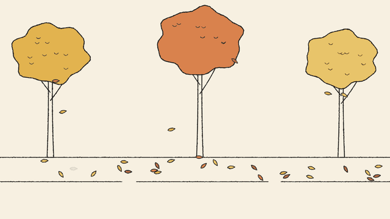
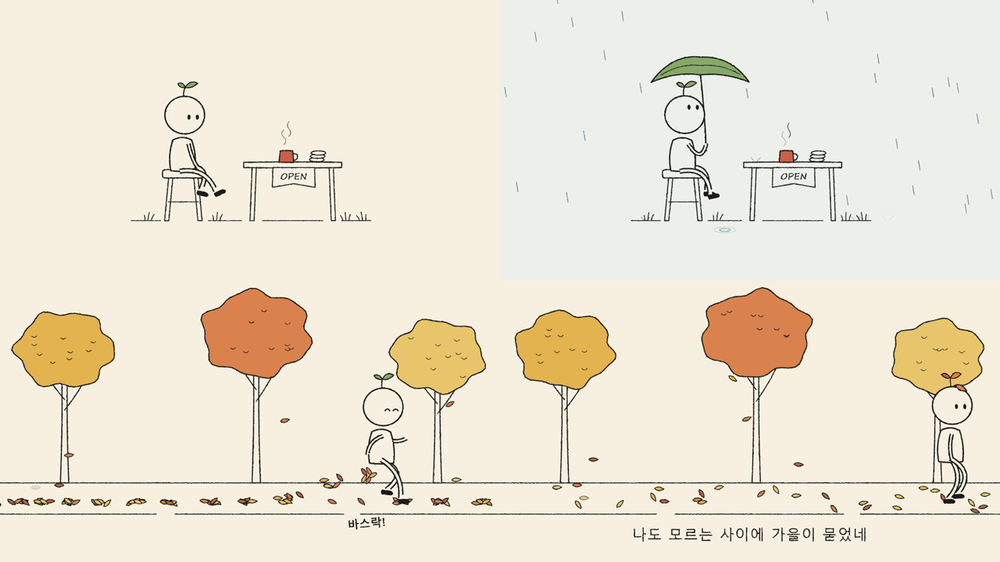

# 새싹이 영상 (saessak-video)

머리에 새싹이 달린 선화 캐릭터 **새싹이**로 SNS용 짧은 루프 애니메이션을 만드는 [Claude Code](https://claude.com/claude-code) 스킬입니다.

"새싹이가 ○○하는 장면 만들어줘"라고 말하면 Claude가 장면을 코드로 그리고, 장면에 맞춘 BGM과 자막까지 넣은 1920×1080 MP4를 만들어 줍니다.





## 특징

- **잉크 펜선 손그림체**: 크림색 종이 위 얇은 펜선, 손으로 그린 듯 살짝 떨리는 선
- **이음매 없는 루프**: 6~10초 영상이 반복 재생돼도 끊기지 않음
- **같은 캐릭터 유지**: 장면이 바뀌어도 새싹이의 생김새와 비율이 그대로
- **합성 BGM·효과음**: 장면 길이에 딱 맞는 피아노·오르골 음악과 바람·바스락·빗방울·띵 효과음을 코드로 만들어 저작권 걱정 없음
- **게시글 문구 자막**: 이야기의 절정에 맞춰 떠오르는 한 줄 자막
- **세로형(9:16)과 워터마크**: `--size 1080x1920`으로 릴스·쇼츠용 세로 영상, `?mark=@계정`으로 하단 워터마크

## 설치

필요한 것: [Claude Code](https://claude.com/claude-code), Node.js 22.18 이상, [ffmpeg](https://ffmpeg.org), Chrome 또는 Edge

macOS / Linux / Git Bash:

```bash
git clone https://github.com/jesuswithme/saessak-video ~/.claude/skills/saessak-video
```

Windows PowerShell:

```powershell
git clone https://github.com/jesuswithme/saessak-video "$env:USERPROFILE\.claude\skills\saessak-video"
```

설치 후 Claude Code를 새로 열면 스킬이 등록됩니다.

## 사용법

Claude Code에서 이런 형식으로 요청하세요.

> **[누가] [어디서] [무엇을 하는] 장면. [분위기]. 게시글 문구: "…"**

```
새싹이가 첫눈 오는 날 혀를 내밀고 눈송이를 받아먹는 장면. 설레는 분위기. 게시글 문구: "올해 첫눈은 너랑"
```

```
새싹이가 낙엽 쌓인 길을 걸으면서 일부러 낙엽만 골라 밟는 장면. 점점 깡총깡총 뛰듯이. 게시글 문구: "바스락 소리 들으려고 일부러 돌아가는 길"
```

```
이 영상에 BGM이랑 자막 넣어줘
```

잘 만드는 요령:

- **움직임은 하나만** 콕 집어 주세요. ("발 동동", "머리 털기", "꾸벅 졸기")
- **감정을 함께** 적으면 속도와 동작 크기가 맞춰집니다. ("기다리다 지친", "신나서 들뜬")
- 마음에 안 들면 **구체적으로** 말해 주세요. ("우산이 너무 커", "다리를 더 느리게")

## 직접 렌더하기

Claude 없이 예제를 바로 영상으로 만들 수도 있습니다.

```bash
cd ~/.claude/skills/saessak-video
node scripts/render.mjs examples/autumn.js --seconds 10 --query caption --music examples/autumn.music.json --out ./out
node scripts/render.mjs examples/sit.js --seconds 6 --out ./out
node scripts/render.mjs examples/sit.js --seconds 6 --name rain --query scene=rain --bg "#edf0ea" --out ./out
node scripts/render.mjs examples/leaves-walk.js --seconds 8 --out ./out
node scripts/render.mjs examples/snow.js --seconds 8 --query caption --music examples/snow.music.json --out ./out
node scripts/render.mjs examples/lastleaf.js --seconds 10 --size 1080x1920 --query "caption&mark=@내계정" --music examples/lastleaf.music.json --out ./out
```

결과: `이름.html`(브라우저에서 바로 움직임), `이름.mp4`, `이름_30s.mp4`(반복본), `이름_bgm.wav`(음악을 넣은 경우)

## 구성

| 경로 | 내용 |
|---|---|
| `SKILL.md` | Claude가 읽는 작업 지침 (장면 규칙, 소리, 자막, 확인 방법) |
| `references/character.md` | 새싹이 치수·색·그리는 순서 |
| `examples/` | 예제 장면 6개(앉기·비·낙엽 밟기·가을·첫눈·세로형 마지막 잎)와 BGM 설정 |
| `scripts/render.mjs` | 장면 → HTML → 프레임 캡처 → MP4 |
| `scripts/music.mjs` | JSON 설정으로 BGM·효과음 합성 |
| `scripts/capture.ts`, `lib/ink.ts` | 프레임 캡처와 선화 그리기 라이브러리 |

## 라이선스

MIT. `lib/ink.ts`와 `scripts/capture.ts`는 [JDhruv14/line-art-animation](https://github.com/JDhruv14/line-art-animation)(MIT)에서 가져왔습니다. 자세한 내용은 [LICENSE](LICENSE)를 참고하세요.
